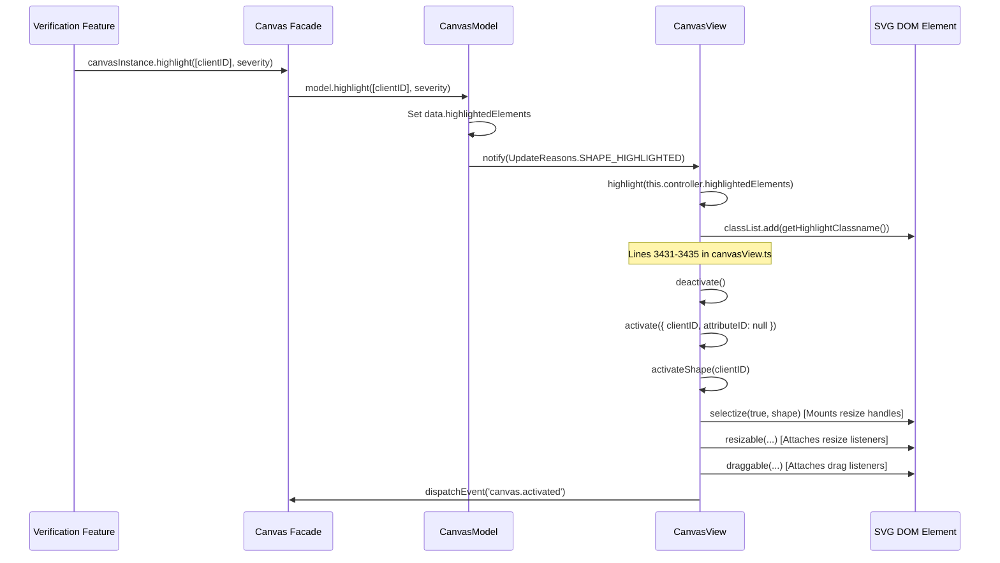

# A3.2 — Validate Skeleton Landmark Identity and Read-Only Highlighting

**Date:** 2026-10-13  
**Target Feature:** Multi-Frame Annotation & Object Verification for 2D Facial Landmarks  
**Active Branch:** `feature/multiframe-annotation`  
**Base Commit:** `0482c4793`  
**Status:** Validated Architecture & Implementation Contract (Source-Verified)

---

## 1. Executive Summary & Verification Classification

This document provides definitive, source-verified validation of the two critical architectural questions identified in discovery report A3.1:
1. **Can skeleton landmarks be resolved deterministically across frames using parent track identity and sublabel metadata?**  
   **Result:** **YES.** Exhaustive code tracing confirms that `SkeletonTrack` instantiates persistent child `Track` instances for every sublabel. An individual landmark element is deterministically identifiable across all frames by the composite key:
   $$\langle \text{Parent Track clientID},\ \text{Sublabel ID} \rangle$$
   In addition, each child `Track` retains an invariant `element.clientID` across frames within the browser session.
2. **Can CVAT's existing `canvasInstance.highlight(...)` API be safely reused on reference frames?**  
   **Result:** **NO.** Source tracing of `CanvasView.highlight()` confirms that it unconditionally calls `this.activate({ clientID })`, attaching interactive SVG resize handles (`selectize`), making the object draggable (`draggable`), and dispatching global canvas events (`canvas.activated`). Using this API on reference frames would violate read-only isolation and risk unintended coordinate mutations. A separate, non-interactive SVG overlay is strictly required.

> [!NOTE]
> **Verification Classification:** All conclusions in this report are classified as **Source-Verified** based on direct, line-by-line inspection of the TypeScript codebase in `cvat-core`, `cvat-canvas`, and `cvat-ui`. Standalone host-side test runners are not configured in this Windows workspace without invoking Docker containers, and per safety constraints, no dependencies were installed or runtime modifications made.

---

## 2. Verified Facts versus Assumptions

| Item / Claim | Initial Assumption (A3.1) | Verified Status (A3.2 Source Trace) | Exact Code Evidence |
| :--- | :--- | :--- | :--- |
| **Skeleton Element Instantiation** | Elements are created per frame dynamically | **Fact:** Elements are created once as persistent `Track` instances in the `SkeletonTrack` constructor | [`cvat-core/src/annotations-objects/skeleton-track.ts#L44-L74`](file:///C:/Users/Menf/cvat/cvat-core/src/annotations-objects/skeleton-track.ts#L44-L74) |
| **Element `clientID` Stability** | Elements might receive fresh `clientID`s on each `get(frame)` | **Fact:** Child `Track` instances preserve their constructor-assigned `clientID` across all `get(frame)` invocations | [`cvat-core/src/annotations-objects/track.ts#L100`](file:///C:/Users/Menf/cvat/cvat-core/src/annotations-objects/track.ts#L100) |
| **Element `serverID` Stability** | Elements share the parent `serverID` | **Fact:** Each child element track receives its own distinct database `_serverId` from the backend | [`cvat-core/src/annotations-objects/skeleton-track.ts#L76-L91`](file:///C:/Users/Menf/cvat/cvat-core/src/annotations-objects/skeleton-track.ts#L76-L91) |
| **Sublabel ID Uniqueness** | Sublabel IDs are unique per skeleton | **Fact:** Sublabel IDs originate from PostgreSQL primary keys (`cvat_label.id`), making them globally unique integers | [`cvat-core/src/labels.ts#L101-L156`](file:///C:/Users/Menf/cvat/cvat-core/src/labels.ts#L101-L156) |
| **Element Array Order** | Array indexing `elements[i]` is stable | **Nuance:** `SkeletonTrack.elements` is explicitly sorted by `label.id`, but matching MUST use `label.id` rather than raw array indices | [`cvat-core/src/annotations-objects/skeleton-track.ts#L73`](file:///C:/Users/Menf/cvat/cvat-core/src/annotations-objects/skeleton-track.ts#L73) |
| **Missing / Outside Elements** | Missing elements might be omitted from the array | **Fact:** `SkeletonTrack.elements` ALWAYS contains all sublabels; absent points are marked `outside: true` | [`cvat-core/src/annotations-objects/skeleton-track.ts#L46-L59`](file:///C:/Users/Menf/cvat/cvat-core/src/annotations-objects/skeleton-track.ts#L46-L59) |
| **Canvas Highlight Safety** | Canvas highlight is a visual CSS toggle | **Fact:** `CanvasView.highlight()` unconditionally activates objects, mounting resize and drag listeners | [`cvat-canvas/src/typescript/canvasView.ts#L3431-L3435`](file:///C:/Users/Menf/cvat/cvat-canvas/src/typescript/canvasView.ts#L3431-L3435) |

---

## 3. Deep-Dive: Skeleton Identity Trace

### 3.1 Construction and Storage of Skeleton Elements
In [`cvat-core/src/annotations-objects/skeleton-track.ts#L44-L74`](file:///C:/Users/Menf/cvat/cvat-core/src/annotations-objects/skeleton-track.ts#L44-L74), the constructor initializes the composite skeleton:
```ts
this.elements = this.label.structure.sublabels.map((sublabel) => {
    const element = data.elements.find((_element) => _element.label_id === sublabel.id);
    const elementData = element || {
        label_id: sublabel.id,
        frame: this.frame,
        attributes: [],
        shapes: [{
            attributes: [],
            points: [cx, cy],
            frame: this.frame,
            occluded: false,
            outside: true,
            rotation: 0,
            type: sublabel.type as unknown as ShapeType,
        }],
    };

    return trackFactory({
        ...elementData,
        group: this.group,
        source: this.source,
        shapes: elementData.shapes.map((shape) => ({
            ...shape,
            z_order: this.shapes[shape.frame]?.zOrder || 0,
        })),
    }, injection.nextClientID(), {
        ...injection,
        parentId: this.clientID,
    });
}).filter(Boolean).sort((a: ImageObject, b: ImageObject) => a.label.id - b.label.id);
```

**Key Architectural Findings:**
1. **Instantiated Once:** `this.elements` is instantiated exactly once when the parent `SkeletonTrack` is built by `AnnotationsCollection.import()`.
2. **Factory Invocation:** Each element is built using `trackFactory()` (creating a `PointsTrack` for landmark vertices).
3. **Dedicated Client ID:** Each element is allocated its own distinct `clientID` via `injection.nextClientID()`.
4. **Parent Reference:** Each element explicitly receives `parentId: this.clientID` in its injection context, establishing `this._parentId = injection.parentId` in [`annotation-common.ts#L41`](file:///C:/Users/Menf/cvat/cvat-core/src/annotations-objects/annotation-common.ts#L41).
5. **Deterministic Ordering:** Elements are explicitly sorted by `a.label.id - b.label.id`.

### 3.2 Element State Retrieval across Frames (`get(frame)`)
When `skeletonTrack.get(frame)` is executed ([`skeleton-track.ts#L194-L230`](file:///C:/Users/Menf/cvat/cvat-core/src/annotations-objects/skeleton-track.ts#L194-L230)):
```ts
const elements = this.elements.map((element) => ({
    ...element.get(frame),
    source: this.source,
    group: this.groupObject,
    zOrder: position.zOrder,
    rotation: 0,
}));
```
Each child `element` executes `Track.prototype.get(frame)` ([`track.ts#L88-L119`](file:///C:/Users/Menf/cvat/cvat-core/src/annotations-objects/track.ts#L88-L119)):
```ts
return {
    ...this.getPosition(frame, prev, next),
    attributes: this.getAttributes(frame),
    descriptions: [...this.descriptions],
    group: this.groupObject,
    objectType: ObjectType.TRACK,
    shapeType: this.shapeType,
    clientID: this.clientID,
    serverID: this._serverId ?? null,
    parentID: this._parentId ?? null,
    ...
};
```
- **Invariant `clientID`:** `this.clientID` returned by `element.get(frame)` is identical regardless of which frame is requested ($F_0, F_1, F_5$).
- **Invariant `parentID`:** `parentID` returned by `element.get(frame)` is always the parent skeleton track's `clientID`.
- **`serverID` Behavior:** If the task annotations have been saved to the server, `serverID` is the integer primary key of that specific element track. If newly created in the session, `serverID` is `null`.

### 3.3 Representation of Absent, Outside, or Unlabeled Landmarks
1. **Fixed Element Count:** The length of `skeletonTrack.elements` never shrinks. Even if a landmark was not annotated on a given frame, the element exists in `this.elements`.
2. **Outside State:**
   - If an element has never been positioned, the constructor creates a default shape with `outside: true`.
   - If an element was marked outside on a frame or falls outside keyframe bounds, `getPosition(frame)` returns `outside: true`.
   - In `ObjectState`, `element.outside === true` denotes that the landmark is absent on that frame.
3. **Occluded State:**
   - If a landmark is physically present but obscured, `element.occluded === true`. It still retains valid coordinates `[x, y]`.

### 3.4 In-Memory Collection Query Mechanics
In [`cvat-core/src/annotations-collection.ts#L407-L448`](file:///C:/Users/Menf/cvat/cvat-core/src/annotations-collection.ts#L407-L448):
1. `collection.tracks` contains top-level `Track` instances, including `SkeletonTrack`. Child element tracks are encapsulated inside `SkeletonTrack.elements`.
2. `collection.get(targetFrame, true, [])` iterates through `collection.tracks`.
3. Calling `skeletonTrack.get(targetFrame)` returns the parent data with nested `elements`.
4. `AnnotationsCollection` wraps this in `new ObjectState(stateData)`.
5. The resulting parent `ObjectState.elements` is an array of child `ObjectState` instances representing the individual landmarks on `targetFrame`.

---

## 4. Deep-Dive: Canvas Highlight & Activation Call Chain

### 4.1 Execution Flow of `canvasInstance.highlight(...)`
Tracing the call chain from public API to DOM manipulation:



### 4.2 Exact Code Walkthrough in `CanvasView`
In [`cvat-canvas/src/typescript/canvasView.ts#L3431-L3435`](file:///C:/Users/Menf/cvat/cvat-canvas/src/typescript/canvasView.ts#L3431-L3435):
```ts
if (this.highlightedElements.elementsIDs.length) {
    this.deactivate();
    const clientID = this.highlightedElements.elementsIDs[0];
    this.activate({ clientID, attributeID: null });
}
```
And inside `activateShape(clientID)` ([`canvasView.ts#L3289-L3375`](file:///C:/Users/Menf/cvat/cvat-canvas/src/typescript/canvasView.ts#L3289-L3375)):
1. **Interactive Controls Mounted:**
   ```ts
   if (state.shapeType !== 'points') {
       this.selectize(true, shape);
   }
   ```
2. **Resize Capability Enabled:**
   ```ts
   this.resizable(state, shape, () => {
       this.mode = Mode.RESIZE;
       ...
   });
   ```
3. **Drag Capability Enabled:**
   ```ts
   if (!state.pinned) {
       this.draggable(state, shape, () => {
           this.mode = Mode.DRAG;
           ...
       });
   }
   ```
4. **Event Emitted to Global Environment:**
   ```ts
   this.canvas.dispatchEvent(
       new CustomEvent('canvas.activated', {
           bubbles: false,
           cancelable: true,
           detail: { state },
       }),
   );
   ```

### 4.3 Why `canvasInstance.highlight()` is Strictly Unsafe for Reference Frames
1. **Loss of Immutability:** Activating a shape makes it sensitive to mouse events. Accidental drags or clicks on a reference frame canvas would enter `Mode.DRAG` or `Mode.RESIZE`.
2. **Global Event Pollution:** The `'canvas.activated'` event is consumed by `cvat-ui` (`objects-list.tsx` and `annotation-reducer.ts`), which updates Redux `state.annotations.activatedStateID` and scrolls the sidebar to that object.
3. **Visual Inconsistency:** `canvas.scss#L359-L389` applies `.cvat-canvas-highlight-enabled`, which turns **all other annotations gray**. In a verification grid, annotators need to see surrounding facial context, not a grayed-out canvas.

---

## 5. Recommended Identity Keys per Annotation Type

To support both saved and unsaved annotations within a session without requiring database migrations:

```
+-----------------------------------------------------------------------------------------+
|                                 SESSION IDENTITY RESOLUTION                             |
+-----------------------------------------------------------------------------------------+
|                                                                                         |
|  1. Top-Level Track (PointsTrack, RectangleTrack)                                        |
|     Primary Key : state.clientID                                                        |
|     Persist Key : state.serverID (if state.serverID !== null)                           |
|     Matching    : targetStates.find(s => s.clientID === selected.clientID)              |
|                                                                                         |
|  2. Skeleton Landmark Element (Child of SkeletonTrack)                                   |
|     Parent Key  : state.parentID (corresponds to SkeletonTrack.clientID)                |
|     Part Key    : state.label.id (sublabel ID, PostgreSQL PK)                           |
|     Part Name   : state.label.name (e.g., "nose_tip", "left_eye")                       |
|     Element Key : state.clientID (invariant session ID of the child Track)              |
|     Matching    : Step 1 -> Find parent skeleton (s.clientID === selected.parentID)     |
|                   Step 2 -> Find child element (el.label.id === selected.label.id)      |
|                                                                                         |
|  3. Standalone Shape / Skeleton (ObjectType.SHAPE)                                      |
|     Status      : NO_IDENTITY                                                           |
|     Action      : Do NOT match across frames. Display warning in verification UI.       |
|                                                                                         |
+-----------------------------------------------------------------------------------------+
```

### Deterministic Resolution Contract:
```ts
export interface IdentityMatchResult {
    status: 'MATCHED' | 'ABSENT_ON_FRAME' | 'SKELETON_ABSENT' | 'NO_IDENTITY';
    targetState: ObjectState | null;
    targetElementState?: ObjectState | null;
    matchedClientID?: number | null;
}

export function resolveCrossFrameIdentity(
    selectedState: ObjectState,
    targetFrameStates: ObjectState[],
): IdentityMatchResult {
    // Standalone shapes cannot be tracked across frames
    if (selectedState.objectType !== 'track') {
        return { status: 'NO_IDENTITY', targetState: null };
    }

    // Case 1: Landmark element within a skeleton track
    if (selectedState.parentID !== null) {
        const parentTrack = targetFrameStates.find((s) => s.clientID === selectedState.parentID);
        if (!parentTrack || parentTrack.outside) {
            return { status: 'SKELETON_ABSENT', targetState: null };
        }

        const landmarkElement = (parentTrack.elements || []).find(
            (el) => el.label.id === selectedState.label.id,
        );

        if (!landmarkElement || landmarkElement.outside) {
            return {
                status: 'ABSENT_ON_FRAME',
                targetState: parentTrack,
                targetElementState: null,
            };
        }

        return {
            status: 'MATCHED',
            targetState: parentTrack,
            targetElementState: landmarkElement,
            matchedClientID: landmarkElement.clientID,
        };
    }

    // Case 2: Top-level track (e.g. PointsTrack, RectangleTrack)
    const matchedTrack = targetFrameStates.find((s) => s.clientID === selectedState.clientID);
    if (!matchedTrack || matchedTrack.outside) {
        return { status: 'ABSENT_ON_FRAME', targetState: null };
    }

    return {
        status: 'MATCHED',
        targetState: matchedTrack,
        matchedClientID: matchedTrack.clientID,
    };
}
```

---

## 6. Recommended Read-Only Reference Overlay Strategy

To achieve completely safe, isolated rendering on reference frames:

### 6.1 Architectural Design
1. **Background Layer:** Each reference frame renders its decoded `ImageBitmap` onto an HTML5 `<canvas>` or an `` tag.
2. **Overlay Layer:** An SVG element is positioned directly above the image with matching dimensions:
   ```html
   <div class="reference-frame-container" style="position: relative; width: 100%; height: 100%;">
       <canvas ref={canvasRef} style="width: 100%; height: 100%; display: block;" />
       <svg 
           viewBox={`0 0 ${frameWidth} ${frameHeight}`} 
           style="position: absolute; top: 0; left: 0; width: 100%; height: 100%; pointer-events: none;"
       >
           {/* Purely declarative, read-only SVG nodes */}
       </svg>
   </div>
   ```
3. **1:1 Coordinate Alignment:**
   - Because `viewBox="0 0 W H"` is set to the natural image width and height, coordinates from `ObjectState.points` (which are in raw pixel space) map directly without manual scaling calculations.
4. **Absolute Isolation (`pointer-events: none`):**
   - No DOM mouse events can be captured by the overlay.
   - Zero interaction, zero drag handlers, zero resize handlers.
   - Absolutely no interaction with `cvat-canvas` controllers, Redux reducers, or undo/redo stacks.

### 6.2 Visual Styling for Highlights and Context
- **Matched Landmark Element:**
  ```html
  <!-- Glowing outer halo ring -->
  <circle cx={x} cy={y} r={8} stroke="#00ffff" stroke-width="2" stroke-dasharray="3,3" fill="none" class="pulse-ring" />
  <!-- Core vertex point -->
  <circle cx={x} cy={y} r={4} fill="#00ffff" stroke="#ffffff" stroke-width="1.5" />
  ```
- **Context Landmark Elements (Other vertices on the same face):**
  ```html
  <circle cx={cx} cy={cy} r={3} fill={element.color || "#ffcc00"} stroke="#000000" stroke-width="1" opacity="0.8" />
  ```
- **Absent Counterpart Handling:**
  - If `status === 'ABSENT_ON_FRAME'`, no circle is rendered.
  - A small HUD overlay tag is rendered in the corner of that frame tile:
    `<div class="frame-badge absent">Landmark absent on Frame #F</div>`
  - Under no circumstances are coordinates interpolated or estimated.

---

## 7. Unresolved Edge Cases & Handling Rules

1. **Unsaved Tracks in the Session:**
   - *Behavior:* If a user adds landmarks and opens `Alt + M` before saving, `serverID` is `null`.
   - *Handling:* Matching uses `clientID` and `label.id`, which are always populated and stable. The feature functions seamlessly on unsaved data.
2. **Dynamic Label Schema Changes:**
   - *Behavior:* If an administrator modifies project sublabels while an annotation session is open.
   - *Handling:* CVAT disallows label schema modifications while tasks have active jobs, rendering this edge case practically impossible during a verification session.
3. **Multiple Skeletons on the Same Frame:**
   - *Behavior:* Video has multiple faces (Face A and Face B).
   - *Handling:* Matching requires `parentID === selected.parentID`. Selecting the nose of Face A will match only Face A's nose on other frames, never jumping to Face B.
4. **Occluded vs. Outside:**
   - *Behavior:* A landmark with `occluded: true` is visible but covered; `outside: true` indicates absence.
   - *Handling:* `occluded` landmarks are rendered with a dashed/translucent marker; `outside` landmarks are never rendered.

---

## 8. Safety and Readiness for Task A4

| Criterion | Evaluation | Safety Status |
| :--- | :--- | :--- |
| **Data Model Compatibility** | Validated against `cvat-core` source | **SAFE** |
| **Deterministic Identity Contract** | Validated: $\langle \text{Parent clientID},\ \text{Sublabel ID} \rangle$ | **SAFE** |
| **Canvas Isolation** | Confirmed: Do not use `canvasInstance.highlight`; use SVG overlay | **SAFE** |
| **State Mutation Prevention** | Confirmed: Read-only query via `job.annotations.get(F, true)` | **SAFE** |
| **Ready for Task A4 (UI & Modal Lifecycle)?** | **YES.** All architectural prerequisites are satisfied. | **READY** |

---

## 9. Verification Summary

- **Deliverable Created:** [`docs/multiframe-discovery/A3.2-identity-validation.md`](file:///C:/Users/Menf/cvat/docs/multiframe-discovery/A3.2-identity-validation.md)
- **Files Inspected:**
  - [`cvat-core/src/annotations-objects/skeleton-track.ts`](file:///C:/Users/Menf/cvat/cvat-core/src/annotations-objects/skeleton-track.ts)
  - [`cvat-core/src/annotations-objects/skeleton-shape.ts`](file:///C:/Users/Menf/cvat/cvat-core/src/annotations-objects/skeleton-shape.ts)
  - [`cvat-core/src/annotations-objects/track.ts`](file:///C:/Users/Menf/cvat/cvat-core/src/annotations-objects/track.ts)
  - [`cvat-core/src/annotations-objects/drawn.ts`](file:///C:/Users/Menf/cvat/cvat-core/src/annotations-objects/drawn.ts)
  - [`cvat-core/src/annotations-objects/annotation-common.ts`](file:///C:/Users/Menf/cvat/cvat-core/src/annotations-objects/annotation-common.ts)
  - [`cvat-core/src/annotations-collection.ts`](file:///C:/Users/Menf/cvat/cvat-core/src/annotations-collection.ts)
  - [`cvat-core/src/object-state.ts`](file:///C:/Users/Menf/cvat/cvat-core/src/object-state.ts)
  - [`cvat-core/src/labels.ts`](file:///C:/Users/Menf/cvat/cvat-core/src/labels.ts)
  - [`cvat-canvas/src/typescript/canvas.ts`](file:///C:/Users/Menf/cvat/cvat-canvas/src/typescript/canvas.ts)
  - [`cvat-canvas/src/typescript/canvasView.ts`](file:///C:/Users/Menf/cvat/cvat-canvas/src/typescript/canvasView.ts)
  - [`cvat-canvas/src/typescript/canvasModel.ts`](file:///C:/Users/Menf/cvat/cvat-canvas/src/typescript/canvasModel.ts)
  - [`cvat-canvas/src/scss/canvas.scss`](file:///C:/Users/Menf/cvat/cvat-canvas/src/scss/canvas.scss)
  - [`cvat-ui/src/components/annotation-page/canvas/views/canvas2d/canvas-wrapper.tsx`](file:///C:/Users/Menf/cvat/cvat-ui/src/components/annotation-page/canvas/views/canvas2d/canvas-wrapper.tsx)
  - [`cvat-ui/src/reducers/annotation-reducer.ts`](file:///C:/Users/Menf/cvat/cvat-ui/src/reducers/annotation-reducer.ts)
