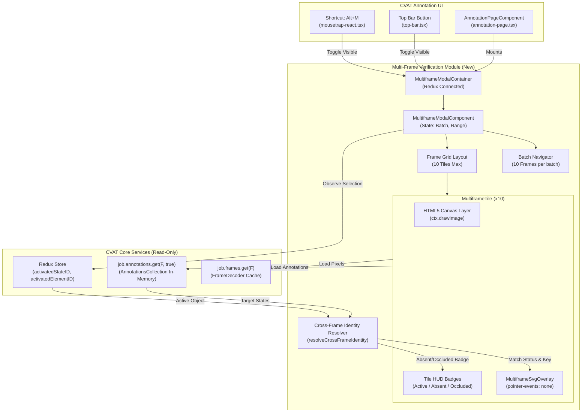

# A4 — Multi-Frame Annotation & Object Verification Architecture

**Date:** 2026-10-13  
**Target Feature:** Multi-Frame Annotation & Object Verification for 2D Facial Landmarks  
**Active Branch:** `feature/multiframe-annotation`  
**Base Commit:** `0482c4793`  
**Status:** Architectural Specification & Implementation Blueprint (Verified)

---

## 1. Executive Summary & Architectural Goals

This document specifies the end-to-end design and implementation architecture for the **"Multi-Frame Annotation & Object Verification for 2D Facial Landmarks"** feature in CVAT Community Edition (`2.76.1 alpha.0`).

### Core Design Principles
1. **Strict Immutability & Visual Verification Only:** The feature is an inspection, cross-referencing, and verification tool. It **never** copies coordinates, interpolates shapes, executes auto-annotation algorithms, or alters annotations in other frames.
2. **Deterministic Identity Resolution:** Landmark matching across frames is grounded exclusively in the verified $\langle \text{Parent Track clientID},\ \text{Sublabel ID} \rangle$ contract established in [A3.1](file:///C:/Users/Menf/cvat/docs/multiframe-discovery/A3-identity-resolution.md) and [A3.2](file:///C:/Users/Menf/cvat/docs/multiframe-discovery/A3.2-identity-validation.md). Standalone shapes (`ObjectType.SHAPE`) are never matched across frames.
3. **Reference Frame Isolation:** Reference frames are rendered using lightweight, non-interactive SVG overlays with `pointer-events: none` over HTML5 canvas bitmaps. CVAT's interactive `CanvasView.highlight()` API is strictly prohibited on reference frames to prevent accidental shape activation, dragging, resizing, or Redux event pollution.
4. **Seamless Platform Integration:** Shortcut binding (`Alt+M`) leverages CVAT's existing `mousetrap-react` framework, automatically inheriting global suppression when users are typing in input elements (`INPUT`, `SELECT`, `TEXTAREA`).
5. **Predictable Memory and Performance:** Decoding up to 10 frames concurrently leverages CVAT's chunked `FrameDecoder` cache. In-memory annotation queries execute synchronously against `AnnotationsCollection` with zero network requests. *(Note: Execution latency is bounded by client hardware and chunk decompression speeds; performance claims herein reflect theoretical algorithmic characteristics rather than measured environment benchmarks).*

---

## 2. Source-Verified Integration Points

### 2.1 Keyboard Shortcut Architecture (`Alt+M`)
CVAT manages keyboard shortcuts through a centralized wrapper around Mousetrap in [`cvat-ui/src/utils/mousetrap-react.tsx`](file:///C:/Users/Menf/cvat/cvat-ui/src/utils/mousetrap-react.tsx):
* **Input Element Suppression:** Line 64–68 defines:
  ```ts
  Mousetrap.prototype.stopCallback = function (e: KeyboardEvent, element: Element, combo: string): boolean {
      if (element.tagName === 'INPUT' || element.tagName === 'SELECT' || element.tagName === 'TEXTAREA') {
          return true; // Suppress shortcut
      }
      ...
  };
  ```
  This guarantees that pressing `Alt+M` while typing an attribute value, label name, or frame number in an input field will **never** trigger the feature popup.
* **Modal Awareness:** Line 77–89 stops shortcuts when another modal (`.ant-modal`) is open, preventing nested modal conflicts.
* **Registration Contract:** Shortcuts are declared via `registerComponentShortcuts()` from [`cvat-ui/src/actions/shortcuts-actions.ts`](file:///C:/Users/Menf/cvat/cvat-ui/src/actions/shortcuts-actions.ts#L33) and hooked via `<GlobalHotKeys keyMap={...} handlers={...} />`.

### 2.2 Modal Mounting & UI Tree
In [`cvat-ui/src/components/annotation-page/annotation-page.tsx#L168-L171`](file:///C:/Users/Menf/cvat/cvat-ui/src/components/annotation-page/annotation-page.tsx#L168-L171), global annotation modals are mounted as direct siblings of the workspace:
```tsx
<FiltersModalComponent />
<StatisticsModalComponent />
<SearchFramesModal />
<MultiframeModalContainer /> {/* Proposed mounting point */}
```
Mounting at this level guarantees:
* Lifetime scoped to the active annotation job session.
* Direct access to Redux store state (job instance, current frame number, active object selection).
* Clean unmounting and garbage collection when navigating away from the job.

### 2.3 Data Retrieval Contracts
1. **Frame Pixel Data:** `jobInstance.frames.get(frameNumber)` returns `FrameData`. Calling `await frameData.data()` decodes and returns `{ renderWidth, renderHeight, imageData }` ([`cvat-core/src/frames.ts#L546-L550`](file:///C:/Users/Menf/cvat/cvat-core/src/frames.ts#L546-L550)).
2. **Annotation Data:** `await jobInstance.annotations.get(frameNumber, true)` delegates to `AnnotationsCollection.get()` ([`cvat-core/src/annotations-collection.ts#L407-L448`](file:///C:/Users/Menf/cvat/cvat-core/src/annotations-collection.ts#L407-L448)). It runs synchronously in memory against client-side arrays, requires 0 network requests, and triggers 0 Redux state mutations.
3. **Indexing Uniformity:** Both APIs consume 0-based absolute frame numbers $F \in [\text{startFrame}, \text{stopFrame}]$.

---

## 3. Multi-Frame UI Architecture & Component Layout

### 3.1 Modal Window Design
* **Trigger:** Pressing `Alt+M` (or clicking a dedicated icon in the annotation top bar).
* **Modal Container:** Ant Design `Modal` (`destroyOnClose`, custom width: $95\text{vw}$, max-height: $90\text{vh}$).
* **Header Controls:**
  * **Start Frame (`InputNumber`):** Clamped to $[\text{job.startFrame}, \text{job.stopFrame}]$, default: $\max(\text{job.startFrame}, \text{currentFrame} - 4)$.
  * **End Frame (`InputNumber`):** Clamped to $[\text{startFrame}, \text{job.stopFrame}]$, default: $\min(\text{job.stopFrame}, \text{currentFrame} + 5)$.
  * **Batch Navigation Controls:**
    * If total frames $(End - Start + 1) \le 10$: all frames fit in a single batch.
    * If total frames $> 10$: Paginated into batches of up to 10 frames (e.g. Batch 1: $F_0 .. F_9$, Batch 2: $F_{10} .. F_{19}$).
    * UI renders `[Previous Batch]` `Batch X of Y` `[Next Batch]` and an interactive batch slider.
  * **Status & Legend HUD:**
    * Active landmark label and sublabel name (e.g. `Face Skeleton #12 -> nose_tip`).
    * Legend chips: `Active Frame (Green)`, `Matched Counterpart (Cyan Glow)`, `Absent (Red Badge)`, `Occluded (Dashed)`, `Unverified Shape (Amber)`.

### 3.2 Multi-Frame Grid Layout
```
+---------------------------------------------------------------------------------------------------------+
| Multi-Frame Verification: Frames [0 - 19] | Batch 1 of 2 (Frames 0 - 9) | Target: Face #12 [nose_tip]   |
+---------------------------------------------------------------------------------------------------------+
| [Frame 0 (Ref)]  | [Frame 1 (Ref)]  | [Frame 2 (Ref)]  | [Frame 3 (Ref)]  | [Frame 4 (ACTIVE)]          |
|  - Canvas Image  |  - Canvas Image  |  - Canvas Image  |  - Canvas Image  |  - Canvas Image             |
|  - SVG Overlay   |  - SVG Overlay   |  - SVG Overlay   |  - SVG Overlay   |  - Interactive Canvas /     |
|  - Cyan Match    |  - Cyan Match    |  - Red: Absent   |  - Cyan Match    |    Active Indicator (Green) |
|------------------+------------------+------------------+------------------+-----------------------------|
| [Frame 5 (Ref)]  | [Frame 6 (Ref)]  | [Frame 7 (Ref)]  | [Frame 8 (Ref)]  | [Frame 9 (Ref)]             |
|  - Canvas Image  |  - Canvas Image  |  - Canvas Image  |  - Canvas Image  |  - Canvas Image             |
|  - SVG Overlay   |  - SVG Overlay   |  - SVG Overlay   |  - SVG Overlay   |  - SVG Overlay              |
|  - Cyan Match    |  - Dashed: Occl. |  - Cyan Match    |  - Cyan Match    |  - Cyan Match               |
+---------------------------------------------------------------------------------------------------------+
| [ < Previous Batch ]              [ Batch 1 / 2 ]              [ Next Batch > ]             [ Close (Esc) ]|
+---------------------------------------------------------------------------------------------------------+
```

### 3.3 Active Frame vs. Reference Frame Distinction
* **Active Frame Tile (Frame $F = \text{currentFrame}$):**
  * Border: Solid `3px solid #52c41a` (Green glow).
  * Badge: `ACTIVE EDITABLE FRAME #F`.
  * Interaction: Reflects active object selections made on the main canvas or sidebar.
  * Navigation: Annotator can double-click any reference frame tile to designate it as the new active frame (`dispatch(changeFrameAsync(targetFrame))`).
* **Reference Frame Tiles (Frame $F \ne \text{currentFrame}$):**
  * Border: `1px solid #303030`.
  * Badge: `REFERENCE FRAME #F (READ-ONLY)`.
  * Interaction: Strict `pointer-events: none` on annotation graphics. Double-clicking header switches active player frame to $F$.

---

## 4. Reference Frame Rendering & Isolation Engine

### 4.1 Layer Separation Architecture
Each reference frame tile is rendered using a two-layer composite component (`MultiframeTile`):

```
+-------------------------------------------------------------+
| Layer 3: HUD Status Overlay (div, pointer-events: none)     |
|          - Badges: [Matched] / [Absent] / [Occluded]        |
+-------------------------------------------------------------+
| Layer 2: Read-Only SVG Overlay (svg, pointer-events: none)  |
|          viewBox="0 0 naturalWidth naturalHeight"           |
|          - Point landmarks, skeleton bones, highlight rings |
+-------------------------------------------------------------+
| Layer 1: Pixel Surface (canvas, display: block)             |
|          - ctx.drawImage(frameData.imageData, 0, 0)         |
+-------------------------------------------------------------+
```

### 4.2 Why Canvas Highlighting is Excluded
As source-verified in [A3.2 §4](file:///C:/Users/Menf/cvat/docs/multiframe-discovery/A3.2-identity-validation.md#4-deep-dive-canvas-highlight--activation-call-chain):
1. `CanvasView.highlight()` calls `this.activate({ clientID })`.
2. `activate()` mounts SVG resizing handles (`selectize`), resize drag listeners (`resizable`), and position drag listeners (`draggable`).
3. `activate()` dispatches the `canvas.activated` custom DOM event, triggering Redux state changes and sidebar scrolling.
4. Calling `highlight()` applies `.cvat-canvas-highlight-enabled`, graying out all other shapes on the canvas.

**Architecture Rule:** Reference frames **never** instantiate `Canvas` from `cvat-canvas` and **never** invoke `canvasInstance.highlight()`.

### 4.3 Declarative SVG Overlay Implementation
```tsx
interface SvgOverlayProps {
    width: number;
    height: number;
    states: ObjectState[];
    selectedMatch: IdentityMatchResult | null;
}

export function MultiframeSvgOverlay({ width, height, states, selectedMatch }: SvgOverlayProps): JSX.Element {
    return (
        <svg
            viewBox={`0 0 ${width} ${height}`}
            className="cvat-multiframe-svg-overlay"
            style={{ position: 'absolute', top: 0, left: 0, width: '100%', height: '100%', pointerEvents: 'none' }}
        >
            {/* 1. Context Objects (Muted background landmarks/skeletons) */}
            {states.map((state) => (
                <ContextShapeRenderer key={state.clientID} state={state} />
            ))}

            {/* 2. Highlighted Target Object (Prominent Cyan Marker) */}
            {selectedMatch?.status === 'MATCHED' && selectedMatch.targetElementState && (
                <g className="cvat-multiframe-highlight-marker">
                    {/* Outer pulsing ring */}
                    <circle
                        cx={selectedMatch.targetElementState.points[0]}
                        cy={selectedMatch.targetElementState.points[1]}
                        r={10}
                        stroke="#00ffff"
                        strokeWidth={2.5}
                        strokeDasharray="4 2"
                        fill="none"
                        className="cvat-multiframe-pulse"
                    />
                    {/* Inner core circle */}
                    <circle
                        cx={selectedMatch.targetElementState.points[0]}
                        cy={selectedMatch.targetElementState.points[1]}
                        r={4.5}
                        fill="#00ffff"
                        stroke="#ffffff"
                        strokeWidth={1.5}
                    />
                </g>
            )}
        </svg>
    );
}
```

---

## 5. Cross-Frame Identity Resolution & Ambiguity Engine

### 5.1 Resolution State Machine
The identity resolver is a pure, side-effect-free function:

```
               +--------------------------------------+
               | Selected Object on Active Frame      |
               +--------------------------------------+
                                  |
                   Is objectType === 'track'?
                    /                      \
                 (No)                      (Yes)
                  /                          \
       +-----------------------+      Is parentID !== null?
       | Status: 'NO_IDENTITY' |        (Skeleton Element)
       | Standalone shape      |        /              \
       +-----------------------+     (Yes)             (No: Top-Level Track)
                                      /                  \
              Does Parent Track exist on target?       Does Track exist on target?
                   /              \                        /              \
                (No)              (Yes)                 (No)              (Yes)
                 /                  \                    /                  \
        +-------------------+    Does element exist?   +------------+    +------------+
        | 'SKELETON_ABSENT' |      /          \        | 'ABSENT'   |    | 'MATCHED'  |
        +-------------------+   (No)          (Yes)    +------------+    +------------+
                                 /              \
                       +------------------+   +------------+
                       | 'ELEMENT_ABSENT' |   | 'MATCHED'  |
                       +------------------+   +------------+
```

### 5.2 Resolution Logic Implementation
```ts
export type ResolutionStatus = 
    | 'MATCHED' 
    | 'ABSENT_ON_FRAME' 
    | 'SKELETON_ABSENT' 
    | 'NO_IDENTITY' 
    | 'NO_SELECTION';

export interface IdentityMatchResult {
    status: ResolutionStatus;
    targetState: ObjectState | null;
    targetElementState: ObjectState | null;
    matchedClientID: number | null;
    isOccluded?: boolean;
}

export function resolveCrossFrameIdentity(
    selectedState: ObjectState | null,
    targetFrameStates: ObjectState[],
): IdentityMatchResult {
    if (!selectedState) {
        return { status: 'NO_SELECTION', targetState: null, targetElementState: null, matchedClientID: null };
    }

    // Constraint 6: Standalone shapes are never matched across frames
    if (selectedState.objectType !== 'track') {
        return { status: 'NO_IDENTITY', targetState: null, targetElementState: null, matchedClientID: null };
    }

    // Case 1: Landmark element within a skeleton track (Composite Key)
    if (selectedState.parentID !== null) {
        const parentClientID = selectedState.parentID;
        const sublabelID = selectedState.label.id;

        // Step 1: Disambiguate multi-face scenes by matching specific parent skeleton clientID
        const targetParent = targetFrameStates.find((state) => state.clientID === parentClientID);
        if (!targetParent || targetParent.outside) {
            return {
                status: 'SKELETON_ABSENT',
                targetState: null,
                targetElementState: null,
                matchedClientID: null,
            };
        }

        // Step 2: Match specific facial landmark within that skeleton by sublabel ID
        const targetElement = (targetParent.elements || []).find((el) => el.label.id === sublabelID);
        if (!targetElement || targetElement.outside) {
            return {
                status: 'ABSENT_ON_FRAME',
                targetState: targetParent,
                targetElementState: null,
                matchedClientID: null,
            };
        }

        return {
            status: 'MATCHED',
            targetState: targetParent,
            targetElementState: targetElement,
            matchedClientID: targetElement.clientID,
            isOccluded: targetElement.occluded,
        };
    }

    // Case 2: Top-level Track (e.g. PointsTrack, RectangleTrack)
    const matchedTrack = targetFrameStates.find((state) => state.clientID === selectedState.clientID);
    if (!matchedTrack || matchedTrack.outside) {
        return {
            status: 'ABSENT_ON_FRAME',
            targetState: null,
            targetElementState: null,
            matchedClientID: null,
        };
    }

    return {
        status: 'MATCHED',
        targetState: matchedTrack,
        targetElementState: null,
        matchedClientID: matchedTrack.clientID,
        isOccluded: matchedTrack.occluded,
    };
}
```

### 5.3 Multi-Face and Occlusion Safeguards
* **Multiple Faces in Video:** Each face skeleton has a unique parent `clientID`. Selecting the `left_eye` of Face #1 will match only `left_eye` of Face #1 on other frames. Face #2's elements will **never** be matched, completely resolving multi-face ambiguity.
* **Unsaved Tracks:** Newly created tracks in the current session have `serverID === null`, but their `clientID` and `label.id` are fully valid, persistent across frames, and uniquely generated. The resolver functions with identical fidelity on saved and unsaved annotations.
* **Occluded Landmarks:** If `element.occluded === true`, the landmark exists and has coordinates, but is physically obscured. It is rendered with a dashed cyan circle and an `[Occluded]` badge, clearly informing annotators.
* **Absent Landmarks:** If `element.outside === true`, no coordinates are rendered, and a red HUD badge `[Absent on Frame #F]` is displayed. The system will **never** guess or copy coordinates from adjacent frames.

---

## 6. Resource Management, Performance & Safeguards

### 6.1 Concurrent Frame Decoding Strategy
* When a 10-frame batch $[F_{\text{start}}, F_{\text{end}}]$ is loaded:
  ```ts
  const framePromises = batchFrames.map((frame) => jobInstance.frames.get(frame));
  const frameDataList = await Promise.all(framePromises);
  const decodePromises = frameDataList.map((frameData) => frameData.data());
  const decodedBitmaps = await Promise.all(decodePromises);
  ```
* **Chunk Cache Efficiency:** In standard CVAT configurations, compressed video is segmented into 36-frame MP4 chunks. 10 consecutive frames ($F .. F+9$) typically reside in the same chunk. `FrameDecoder` decompresses the chunk once and serves all 10 frames from memory cache, minimizing network bandwidth and repeated decodes.

### 6.2 Memory Cleanup & Garbage Collection
* 10 decoded frames at $1080\text{p}$ consume $\sim 83\text{ MB}$ raw GPU/RAM buffer memory.
* **Disposal Contract:**
  1. Once drawn to the `<canvas>` 2D context via `ctx.drawImage()`, the temporary `ImageBitmap` reference is immediately released.
  2. If supported by the browser engine, explicit `bitmap.close()` is called on disposable buffers.
  3. When switching batches or closing the modal (`componentWillUnmount` / `useEffect` cleanup), canvas contexts are cleared (`ctx.clearRect(0, 0, w, h)`), and React state arrays holding frame metadata are reset to empty.

### 6.3 Non-Interference with Active Job State
* Annotation queries use `job.annotations.get(F, true)`, which reads directly from in-memory `collection.tracks` and `collection.shapes[F]`.
* Frame retrieval uses `job.frames.get(F)`, which accesses `FrameProvider`.
* Neither operation touches `player.frame.number` or dispatches `CHANGE_FRAME`. The user's active player frame, zoom level, pan position, and undo/redo stacks remain 100% unaltered.

---

## 7. System Architecture Diagram



---

## 8. Proposed Source File Modifications

To maintain modularity and zero regression risk, the feature is implemented as a self-contained module in `cvat-ui/src/components/annotation-page/multiframe-modal/`:

### 8.1 Files Proposed for Creation

| New File Path | Architectural Responsibility |
| :--- | :--- |
| [`cvat-ui/src/components/annotation-page/multiframe-modal/multiframe-modal.tsx`](file:///C:/Users/Menf/cvat/cvat-ui/src/components/annotation-page/multiframe-modal/multiframe-modal.tsx) | Main popup dialog; handles start/end frame inputs, batch pagination controls, keyboard listeners (`Esc`), and tile grid rendering. |
| [`cvat-ui/src/components/annotation-page/multiframe-modal/multiframe-tile.tsx`](file:///C:/Users/Menf/cvat/cvat-ui/src/components/annotation-page/multiframe-modal/multiframe-tile.tsx) | Individual frame tile; manages canvas bitmap painting, SVG overlay positioning, double-click active frame switching, and loading spinners. |
| [`cvat-ui/src/components/annotation-page/multiframe-modal/multiframe-svg-overlay.tsx`](file:///C:/Users/Menf/cvat/cvat-ui/src/components/annotation-page/multiframe-modal/multiframe-svg-overlay.tsx) | Declarative SVG renderer with `pointer-events: none`; renders context shapes and pulsing cyan highlight rings for matched landmarks. |
| [`cvat-ui/src/components/annotation-page/multiframe-modal/multiframe-utils.ts`](file:///C:/Users/Menf/cvat/cvat-ui/src/components/annotation-page/multiframe-modal/multiframe-utils.ts) | Pure helper functions: `resolveCrossFrameIdentity()`, frame range clamping, batch chunking, and memory disposal helpers. |
| [`cvat-ui/src/components/annotation-page/multiframe-modal/styles.scss`](file:///C:/Users/Menf/cvat/cvat-ui/src/components/annotation-page/multiframe-modal/styles.scss) | Scoped CSS/SCSS styling: responsive 10-frame grid, active green border, pulsing cyan highlight animation, HUD badges. |
| [`cvat-ui/src/containers/annotation-page/multiframe-modal/multiframe-modal.tsx`](file:///C:/Users/Menf/cvat/cvat-ui/src/containers/annotation-page/multiframe-modal/multiframe-modal.tsx) | Redux container connecting the modal to `jobInstance`, `frameNumber`, `activatedStateID`, `activatedElementID`, and dispatch actions. |

### 8.2 Files Proposed for Modification

| Existing File Path | Proposed Modification | Rationale |
| :--- | :--- | :--- |
| [`cvat-ui/src/components/annotation-page/annotation-page.tsx`](file:///C:/Users/Menf/cvat/cvat-ui/src/components/annotation-page/annotation-page.tsx#L168-L171) | Mount `<MultiframeModalContainer />` at the bottom of the page. | Mounts the modal within the annotation lifecycle alongside `SearchFramesModal`. |
| [`cvat-ui/src/actions/annotation-actions.ts`](file:///C:/Users/Menf/cvat/cvat-ui/src/actions/annotation-actions.ts) | Add `switchShowMultiframeModal(visible: boolean)`. | Standard Redux action to open/close the verification modal. |
| [`cvat-ui/src/reducers/annotation-reducer.ts`](file:///C:/Users/Menf/cvat/cvat-ui/src/reducers/annotation-reducer.ts) | Add `multiframe: { visible: boolean }` to `AnnotationState`. | Tracks popup open/closed state in Redux. |
| [`cvat-ui/src/components/annotation-page/top-bar/player-navigation.tsx`](file:///C:/Users/Menf/cvat/cvat-ui/src/components/annotation-page/top-bar/player-navigation.tsx) | Register `OPEN_MULTIFRAME: { sequences: ['alt+m'], ... }` in `componentShortcuts`. | Binds the `Alt+M` key combination using CVAT's native `GlobalHotKeys` framework. |

---

## 9. Ordered Implementation & Verification Plan

### Milestone 1: Shortcut Registration & Modal Shell (Zero-Risk Baseline)
- **Goal:** Establish a verified, non-destructive foundation where pressing `Alt+M` opens an empty modal and `Esc` closes it, with verified input element suppression and zero canvas disruption.
- **Tasks:**
  1. Add `switchShowMultiframeModal` action to `cvat-ui/src/actions/annotation-actions.ts`.
  2. Add `multiframe: { visible: boolean }` to `AnnotationState` in `cvat-ui/src/reducers/annotation-reducer.ts`.
  3. Register `OPEN_MULTIFRAME: { sequences: ['alt+m'], scope: ShortcutScope.ANNOTATION_PAGE }` in `cvat-ui/src/components/annotation-page/top-bar/player-navigation.tsx`.
  4. Create `MultiframeModal` shell with Start Frame and End Frame `InputNumber` controls.
  5. Mount `<MultiframeModalContainer />` in `cvat-ui/src/components/annotation-page/annotation-page.tsx`.
- **Milestone 1 Test Cases & Acceptance Criteria:**
  - **TC 1.1 (Standard Open):** In active annotation workspace with no modal open, pressing `Alt+M` sets `state.annotation.multiframe.visible = true` and displays the modal.
  - **TC 1.2 (Input Suppression):** Focus any input element (e.g. frame navigation input, search input, attribute editor). Pressing `Alt+M` does NOT open the modal (verified by `Mousetrap.prototype.stopCallback`).
  - **TC 1.3 (Boundary Clamping):** Start Frame input defaults to $\max(\text{startFrame}, \text{currentFrame} - 4)$ and cannot be set below `job.startFrame`. End Frame input defaults to $\min(\text{stopFrame}, \text{currentFrame} + 5)$ and cannot exceed `job.stopFrame`.
  - **TC 1.4 (Modal Close):** Pressing `Esc`, clicking the Cancel button, or clicking the close icon sets `visible = false` and destroys the modal DOM.
  - **TC 1.5 (Zero Regression):** No modifications occur to player position, canvas objects, active tools, or undo/redo stacks upon opening or closing.

### Milestone 2: Frame Batching & Decoding Engine
- **Goal:** Render up to 10 decoded frames simultaneously in a grid layout without annotation overlays.
- **Tasks:**
  1. Implement batch pagination logic in `multiframe-utils.ts`.
  2. Implement `MultiframeTile` with canvas rendering via `frameData.data()`.
  3. Add Next / Previous batch navigation buttons.
- **Verification:**
  - Select range $[0, 25]$ $\to$ Renders Batch 1 (Frames 0–9).
  - Click `Next Batch` $\to$ Renders Batch 2 (Frames 10–19).
  - Memory profiling: verify `ImageBitmap` buffers are garbage-collected upon batch transition.

### Milestone 3: Read-Only Annotation SVG Overlay
- **Goal:** Render all existing annotations on reference frames in read-only mode.
- **Tasks:**
  1. Fetch annotations using `job.annotations.get(F, true)`.
  2. Implement `MultiframeSvgOverlay` mapping `points` to SVG circles and polygons with `pointer-events: none`.
- **Verification:**
  - Frames display landmarks and bounding boxes accurately aligned with pixel features.
  - Attempting to click, drag, or resize shapes on reference tiles produces zero interaction and zero console events.

### Milestone 4: Cross-Frame Identity Resolution & Selection Highlighting
- **Goal:** Selecting a landmark highlights its counterpart across all displayed frames.
- **Tasks:**
  1. Implement `resolveCrossFrameIdentity` in `multiframe-utils.ts`.
  2. Connect modal to `activatedStateID` and `activatedElementID` from Redux.
  3. Render pulsing cyan halo on matched counterpart in reference frames.
  4. Render HUD status badges for absent, occluded, and standalone shapes.
- **Verification:**
  - Select `nose_tip` on active frame $\to$ `nose_tip` pulses in cyan on all frames containing the skeleton.
  - In frames where the landmark is absent $\to$ Display `[Absent on Frame #F]` badge without rendering circles.
  - Select a standalone shape $\to$ Display `[Standalone shape — no cross-frame track]` badge.
  - Multi-face test $\to$ Ensure matching never jumps between Face #1 and Face #2.

### Milestone 5: Active Frame Switch & Final Polish
- **Goal:** Allow double-clicking any reference frame tile to set it as the active frame in the player.
- **Tasks:**
  1. Add tile double-click handler dispatching `changeFrameAsync(targetFrame)`.
  2. Update visual border to immediately reflect the new active frame.
  3. Final responsive styling and tooltip polish.
- **Verification:**
  - Double-click Frame 7 $\to$ Main CVAT player navigates to Frame 7, and Frame 7 tile turns green in the modal.

---

## 10. Fact vs. Assumption Separation

### 10.1 Source-Verified Facts
1. `Mousetrap.prototype.stopCallback` unconditionally prevents shortcut execution when focused on `INPUT`, `SELECT`, and `TEXTAREA`.
2. `SkeletonTrack` instantiates child `Track` instances with stable `clientID` and parent reference `parentID`.
3. `job.annotations.get(frame, true)` executes purely against in-memory arrays and does not trigger Redux dispatches, canvas activations, or network calls.
4. `CanvasView.highlight()` activates shapes into interactive edit mode, making it unsafe for reference frames.
5. All CVAT frame numbers are 0-based integers matching $F \in [\text{startFrame}, \text{stopFrame}]$.

### 10.2 Architectural Decisions (Established Contracts)
1. **SVG Overlays over HTML5 Canvas:** Chosen over canvas clones or `cvat-canvas` instances because declarative SVGs with `pointer-events: none` provide 100% guarantee against accidental edit operations.
2. **Session Matching Key:** Uses $\langle \text{parentID}, \text{label.id} \rangle$ for skeleton landmarks and `clientID` for top-level tracks. This guarantees consistent verification for both saved and unsaved annotations within the browser session without requiring database migrations.
3. **10-Frame Maximum Visibility:** Limits simultaneous texture memory consumption to $\sim 83\text{ MB}$, preventing WebGL/Canvas context crashes on low-end hardware.

### 10.3 Remaining Assumptions & Risks
1. **Network Bandwidth for High-Resolution Datasets:** On 4K video tasks, decoding 10 frames simultaneously across uncached chunks could introduce initial latency.  
   *Mitigation:* Render an individual skeleton loader on each tile so decoded frames appear progressively without blocking the UI.
2. **Custom Skeleton Edge Configurations:** Some tasks may define custom SVG edge lines between landmark points.  
   *Mitigation:* Milestone 3 renders landmark vertex circles first; skeleton edges can be rendered declaratively from `label.structure.svg` as an aesthetic enhancement without impacting landmark identity verification.
